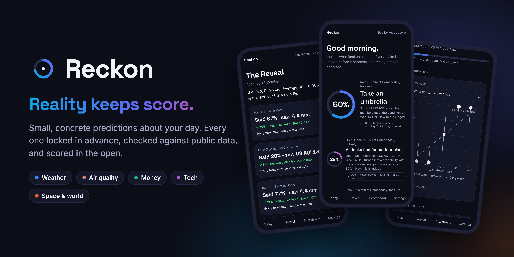
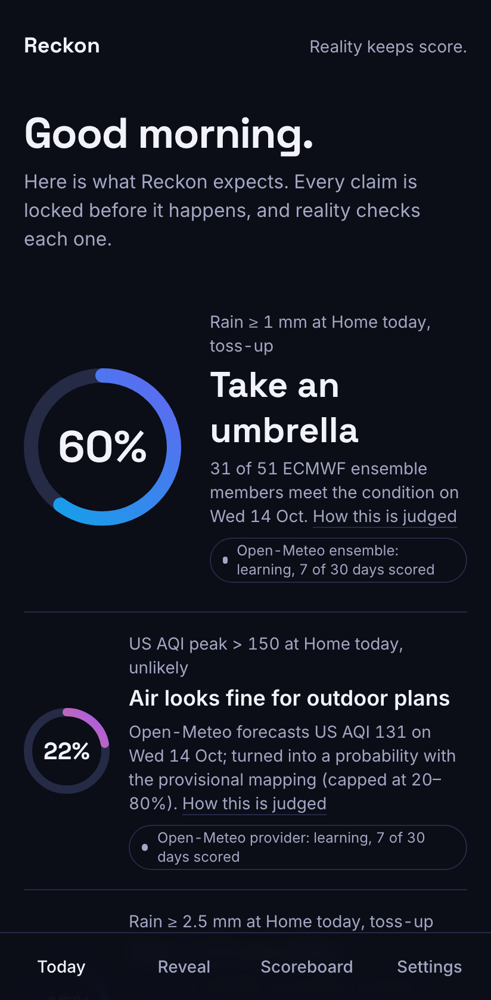
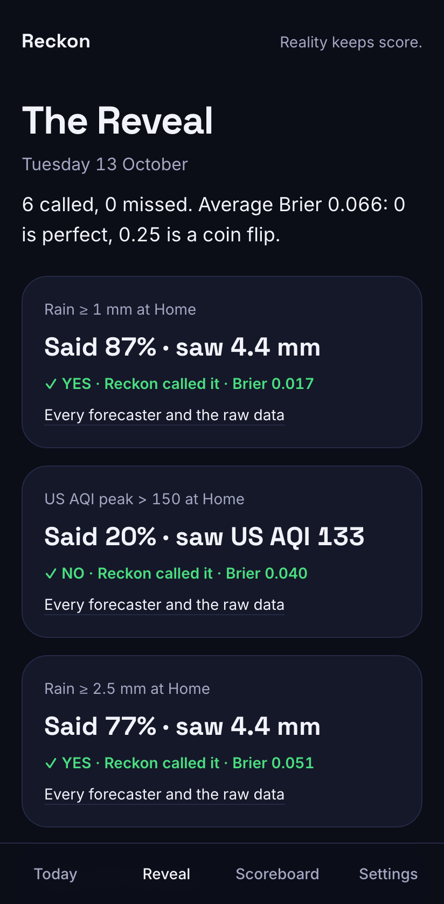
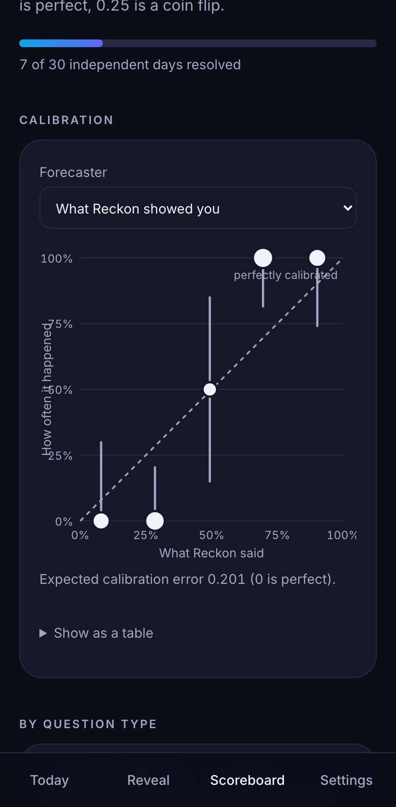
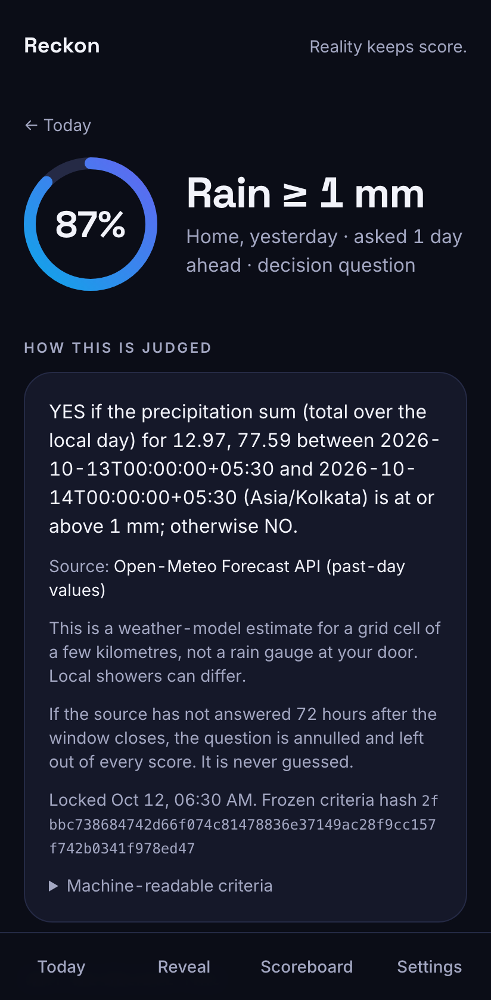
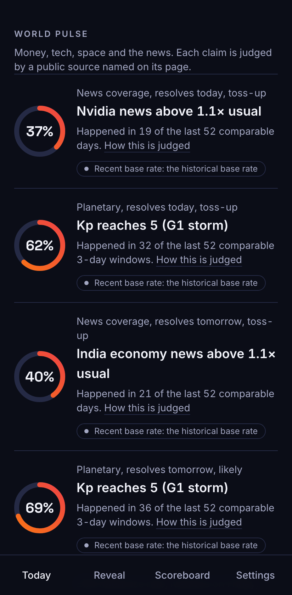
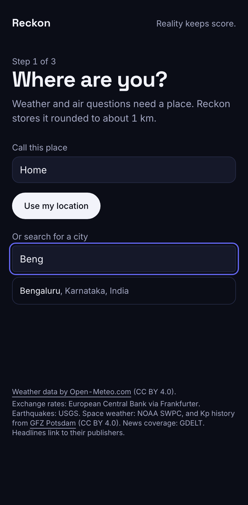
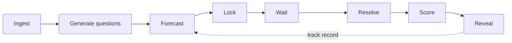

<div align="center">

<picture>
  <source media="(prefers-color-scheme: light)" srcset="docs/assets/hero-light.png" />
  
</picture>

# Reckon

**Reality keeps score.**

A self-hosted forecasting companion that makes small, concrete predictions about your day,<br />
checks every one against a public data source, and shows you exactly how trustworthy each kind of prediction is.

[](https://github.com/PrataapMS/reckon/actions/workflows/ci.yml)
[](https://github.com/PrataapMS/reckon/actions/workflows/contracts.yml)
[](LICENSE)
[](.nvmrc)
[](tsconfig.json)
[](apps/web)
[](docs/spec/05-operations.md)
[](CONTRIBUTING.md)

[Features](#features) · [Screenshots](#screenshots) · [How it works](#how-it-works) · [Get started](#get-started) · [Roadmap](#roadmap) · [Contributing](#contributing)

</div>

---

## Why Reckon?

Weather apps say "60% chance of rain" and never tell you how often their 60% was right. Reckon does.

Every morning it writes a handful of yes/no questions about your near future ("Rain ≥ 1 mm at Home today?", "US AQI above 150 tomorrow?", "Kp reaches 5 this week?"). Each question's **source, metric, threshold and time window are frozen** before it opens, and every forecaster's probability is **locked** in an append-only ledger. Each evening the answers come in from the declared source, the cards flip open, and the scores land on a public-by-design scoreboard.

It never claims to know the future. It measures what is predictable, and shows its working.

> [!NOTE]
> Reckon is in active development. Phases 0 to 2 (daily brief, reveal, World Pulse, scoreboard v1, Telegram and Web Push) are built and verified on a fake clock. See the [roadmap](#roadmap).

## Features

| | |
| --- | --- |
| ☀️ **Morning brief** | Weather and air-quality claims for your places, each led by an action ("Take an umbrella"), a probability ring and its track record. |
| 🌍 **World Pulse** | Money (USD/INR), earthquakes, geomagnetic storms, software releases, service incidents and news surges, all judged by public sources. |
| 🔒 **Locked before it happens** | Forecasts and resolutions are append-only, enforced by database triggers. Criteria are hashed at creation and never change. |
| 🎴 **The Reveal** | Sealed cards flip open in the evening with the observed value, the outcome and a Brier score. |
| 📊 **Honest scoreboard** | Brier score per question type and forecaster, plus a reliability diagram with a table and text summary. Trust labels are earned only after 30 independent days beat the base rate with 95% confidence. |
| 🔎 **Full transparency** | Every question shows how it is judged, every forecaster's number, the headlines behind it, and a download of the raw source response. |
| 📰 **Why we believe this** | Headlines from GDELT, RSS and Hacker News are linked to each claim as context. Headlines never decide the answer. |
| 📬 **Delivered your way** | Installable PWA, a Telegram bot (`/brief`, `/reveal`, `/pause`, `/stop`) and Web Push. Quiet hours and a two-push daily cap are built in. |
| 🛟 **Fails loud, degrades safe** | If a source does not answer within 72 hours, the question is annulled with a reason and left out of every score. It is never guessed. |
| ♿ **Accessible** | WCAG 2.2 AA in light and dark themes (axe-core checked in CI), keyboard reachable, reduced-motion aware, probabilities announced as words. |
| 💸 **$0 to run** | Built for Netlify Free, Neon Free and GitHub Free at single-user scale. |

## Screenshots

<table>
  <tr>
    <td align="center" width="25%">
      <picture><source media="(prefers-color-scheme: light)" srcset="docs/assets/screens/light-today.png" /></picture>
      <br /><sub><b>Today</b><br />The morning brief</sub>
    </td>
    <td align="center" width="25%">
      <picture><source media="(prefers-color-scheme: light)" srcset="docs/assets/screens/light-reveal.png" /></picture>
      <br /><sub><b>The Reveal</b><br />What happened, scored</sub>
    </td>
    <td align="center" width="25%">
      <picture><source media="(prefers-color-scheme: light)" srcset="docs/assets/screens/light-scoreboard.png" /></picture>
      <br /><sub><b>Scoreboard</b><br />Calibration in the open</sub>
    </td>
    <td align="center" width="25%">
      <picture><source media="(prefers-color-scheme: light)" srcset="docs/assets/screens/light-detail.png" /></picture>
      <br /><sub><b>How this is judged</b><br />Frozen criteria and source</sub>
    </td>
  </tr>
  <tr>
    <td align="center">
      <picture><source media="(prefers-color-scheme: light)" srcset="docs/assets/screens/light-world.png" /></picture>
      <br /><sub><b>World Pulse</b><br />Money, tech, space, news</sub>
    </td>
    <td align="center">
      <picture><source media="(prefers-color-scheme: light)" srcset="docs/assets/screens/light-onboarding.png" /></picture>
      <br /><sub><b>Onboarding</b><br />Three steps, under 5 minutes</sub>
    </td>
    <td colspan="2" valign="middle">
      <sub>Screenshots follow your GitHub theme (light or dark). They are generated from the real app on a deterministic fake clock with <code>pnpm --filter @reckon/e2e screenshots</code>, so they never drift from the UI.</sub>
    </td>
  </tr>
</table>

## How it works

Reckon writes and forecasts questions overnight, briefs you in the morning, and reveals the verdicts in the evening.



| Time (local) | Reckon | You |
| --- | --- | --- |
| 05:00 | Generates questions and collects every forecaster's probability | Nothing; this runs silently |
| 06:30 | Sends the Morning Brief | Today screen plus Telegram or Web Push |
| Hourly | Ingests news and refreshes evidence | "Why we believe this" panels update |
| 21:00 | Resolves finished questions and scores them | The Reveal: cards flip open |

**Forecasters compete on the same questions.** Each question is forecast by several methods (the ECMWF 51-member ensemble, the provider's own forecast, a 10-year climatology, persistence, recent base rates, NOAA SWPC's storm probabilities). A forecaster earns the spotlight only by beating the free baselines.

**Scoring** uses the [Brier score](https://en.wikipedia.org/wiki/Brier_score): 0 is perfect, 0.25 is a coin flip. Trust labels (`Learning`, `Proven skill`, `No proven edge`) come from a cluster bootstrap of the Brier skill score.

### What it predicts today

| Topic | Example question | Judged by |
| --- | --- | --- |
| Weather | Rain ≥ 1 mm at Home tomorrow? Max ≥ 31 °C on Thursday? | Open-Meteo past-day values |
| Air | US AQI max > 150 at Home tomorrow? | Open-Meteo Air Quality (CAMS) |
| Money | USD/INR higher Friday than Monday? | ECB rates via Frankfurter |
| World | At least one M6.5+ quake worldwide this week? | USGS |
| Space | Kp reaches 5 (G1 storm) in the next 3 days? | NOAA SWPC |
| Tech | Does a watched repo ship a stable release this week? Does GitHub report a critical incident? | GitHub API, Statuspage |
| News | Is coverage of a tracked topic above k× its 30-day median? | GDELT |

Thresholds adapt to your place and season, so questions stay genuinely uncertain instead of trivially yes or no.

## Get started

### Prerequisites

- Node.js 24 (`nvm use` reads [.nvmrc](.nvmrc))
- pnpm 9 (`corepack enable`)
- Docker for local Postgres, or a free [Neon](https://neon.com) project

### Run it locally

```bash
git clone https://github.com/PrataapMS/reckon.git && cd reckon
pnpm install
cp .env.example .env            # defaults work with local Docker
pnpm verify                     # lint, typecheck, architecture rules, unit tests, build

pnpm db:up && pnpm db:migrate && pnpm db:seed
pnpm dev:api                    # terminal 1: http://localhost:8787/api/v1/health
pnpm dev:web                    # terminal 2: http://localhost:5173
```

Set a passphrase to enable sign-in and the daily brief:

```bash
pnpm --filter @reckon/api hash-passphrase "choose a long passphrase"
# paste the output into PASSPHRASE_HASH in .env
```

Run the daily loop by hand (every job is idempotent):

```bash
pnpm job generate   # write questions and lock forecasts
pnpm job tick       # lock, resolve, send the outbox
pnpm job reveal     # resolve and send the reveal
pnpm job news       # fetch and link headlines
```

### Deploy for free

Reckon ships ready for **Netlify** (static PWA plus scheduled functions) and **Neon** (serverless Postgres). Telegram and Web Push are optional. The full walkthrough, including secrets, the Telegram webhook and nightly encrypted backups, is in [docs/GETTING_STARTED.md](docs/GETTING_STARTED.md).

<details>
<summary><b>Environment variables</b></summary>

| Variable | Required | Purpose |
| --- | --- | --- |
| `DATABASE_URL` | Yes | Postgres connection string (Neon pooled URL in production) |
| `SESSION_SECRET` | Yes | 32+ random bytes for session signing |
| `PASSPHRASE_HASH` | Yes | Output of `hash-passphrase` |
| `DEFAULT_LAT` / `DEFAULT_LON` / `DEFAULT_TZ` | Yes | Place used until onboarding stores one |
| `CONTACT_EMAIL` | Yes | Sent in the User-Agent to data providers |
| `TELEGRAM_BOT_TOKEN` / `TELEGRAM_BOT_USERNAME` / `TELEGRAM_WEBHOOK_SECRET` | No | Telegram delivery |
| `VAPID_PUBLIC_KEY` / `VAPID_PRIVATE_KEY` | No | Web Push (`pnpm push:keys`) |
| `GITHUB_TOKEN` | No | Lifts GitHub's 60 requests/hour limit for release checks |
| `EVIDENCE_STORE` | No | `netlify`, `fs` or `memory` |

See [.env.example](.env.example) for every option.

</details>

## Platforms

| Platform | Status |
| --- | --- |
| 🌐 Web app (installable PWA, offline brief) | ✅ Available |
| 💬 Telegram bot | ✅ Available |
| 🔔 Web Push (Android, desktop, iOS when installed) | ✅ Available |
| 🤖 Android app (F-Droid and Google Play) | 🗓️ Planned |

## Roadmap

- [x] **Phase 0: Foundations.** Monorepo, append-only ledger, work queue, CI, backups.
- [x] **Phase 1: Daily Brief MVP.** Weather and air questions, four forecasters, resolver, reveal, Telegram, PWA.
- [x] **Phase 2: World Pulse.** Nine new data sources, eleven templates, news evidence, scoreboard v1, Web Push.
- [ ] **Phase 3: Honest scoreboard and the habit.** Trust labels, champion selection, calibration views, streaks, "Call it" (you vs Reckon), weekly report, custom questions, data export.
- [ ] **Phase 4: Learning Reckon.** A blended forecaster fitted by backtest, an evidence-reading LLM forecaster with guardrails, crowd baselines, attention surges.
- [ ] **Phase 5: Life integration.** Opt-in Todoist and Google Calendar questions, scored in their own bucket.
- [ ] **Phase 6: Decisions.** Action cards only from question types with proven skill, each with its justifying record.

Details and acceptance criteria: [docs/spec/06-roadmap.md](docs/spec/06-roadmap.md).

## Tech stack

<p>
  
  
  
  
  
  
  
  
  
  
  
</p>

- **Hexagonal architecture.** Pure domain code (no I/O, clock or randomness), use cases that depend only on ports, and adapters wired in one composition root. Layering is enforced by dependency-cruiser in CI.
- **Validated at the edge.** All external data enters through Zod; expected failures are `Result<T, E>`, not exceptions.
- **Tested at every layer.** Unit and property tests, Postgres integration tests for the ledger rules, nightly live contract tests against every data source, and Playwright E2E with axe-core in both themes.

Architecture decisions are recorded in [docs/adr](docs/adr); the full product and engineering spec is in [docs/spec](docs/spec/00-index.md).

<details>
<summary><b>Repository map</b></summary>

```text
apps/
  api/          Hono API (/api/v1)
  jobs/         Scheduled jobs: generate, tick, brief, reveal, news
  web/          Vite + React PWA: Today, Reveal, Scoreboard, Settings
netlify/
  functions/    Netlify entry points (API and scheduled jobs)
packages/
  core/         Pure domain (scoring, criteria, lifecycle), ports, use cases
  contracts/    Zod API schemas shared by API and web
  adapters/     Data sources, Postgres repositories, Telegram, Web Push
  db/           SQL migrations with integrity triggers, Drizzle schema
  runtime/      Config, logger, composition root
e2e/            Playwright tests and README screenshots on a fake clock
docs/
  spec/         Product and engineering spec
  adr/          Architecture decision records
  runbooks/     What to do when something breaks
```

</details>

<details>
<summary><b>Commands</b></summary>

| Command | Does |
| --- | --- |
| `pnpm verify` | Lint, typecheck, architecture rules, unit tests, build |
| `pnpm test` / `pnpm test:watch` | Unit tests |
| `pnpm test:integration` | Database tests (needs `DATABASE_URL`) |
| `pnpm test:contracts` | Live data-source contract tests |
| `pnpm test:e2e` | Playwright E2E, light and dark, with axe-core |
| `pnpm db:up` / `db:migrate` / `db:seed` | Local Postgres, migrations, seed |
| `pnpm dev:api` / `pnpm dev:web` | API on :8787, PWA on :5173 |
| `pnpm job <tick\|generate\|brief\|reveal\|news>` | Run a scheduled job by hand |
| `pnpm push:keys` | Generate VAPID keys for Web Push |
| `pnpm --filter @reckon/e2e screenshots` | Regenerate the README images |

</details>

## Privacy

Reckon is single-user and self-hosted: your data lives in your own database.

- No analytics, no ads, no tracking.
- Locations are stored rounded to about 1 km.
- Data providers receive only coordinates or public identifiers, plus the operator's contact email in the User-Agent as good API etiquette.
- Integrations (planned) use read-only scopes, with tokens encrypted at rest.

## Contributing

Contributions are welcome. Start with [CONTRIBUTING.md](CONTRIBUTING.md) for the architecture rules and workflow. Adding a new data source is the most common change and needs one adapter, one template and no changes to core code.

Please use [Conventional Commits](https://www.conventionalcommits.org/) and run `pnpm verify` before opening a pull request.

## Data sources and attribution

Weather and air-quality data by [Open-Meteo.com](https://open-meteo.com/) ([CC BY 4.0](https://creativecommons.org/licenses/by/4.0/)), used under its free non-commercial terms. Exchange rates: European Central Bank via [Frankfurter](https://frankfurter.dev/). Earthquakes: [USGS](https://earthquake.usgs.gov/) (public domain). Space weather: [NOAA SWPC](https://www.swpc.noaa.gov/) (public domain) and Kp history from [GFZ Potsdam](https://kp.gfz.de/) (CC BY 4.0). News coverage: [GDELT](https://www.gdeltproject.org/). Headlines are shown as title, source, time and a short snippet, always linking to the publisher.

The data remains under its providers' terms; the license below covers Reckon's code only. If you run Reckon commercially, check each provider's terms (Open-Meteo offers a commercial API plan).

## License

Reckon is free software, licensed under the [GNU Affero General Public License v3.0 or later](LICENSE).

You may use, study, modify and share it. If you distribute it, or run a modified version as a network service, you must make your source code available under the same license.

<div align="center">
<sub>Reality keeps score.</sub>
</div>
