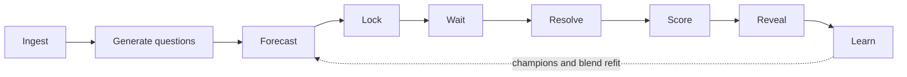

# 1. Product

## 1.1 Vision

Reckon makes small, concrete predictions about your near future, checks every one of them against reality, and shows you exactly how trustworthy each kind of prediction is.

**Tagline: Reality keeps score.** Alternates: "Forecast. Verify. Get sharper." and "Know what's knowable."

To *reckon* is to estimate ("I reckon it'll rain"). A *reckoning* is the moment the account is settled. Reckon does both, every day, automatically.

**What Reckon is**

- A daily briefing of probabilities that matter to you: rain, air quality, currency moves, tech releases, outages, world events.
- A permanent, append-only ledger of every forecast it has ever made.
- An automatic referee that resolves each forecast from a pre-declared data source and scores it.
- A scoreboard that tells you, per topic, whether its forecasts beat freely available baselines.

**What Reckon is not**

- Not an oracle. It never claims to know the future; it measures what is predictable.
- Not a trading or investment tool. Market questions exist to test honesty, not to advise trades.
- Not a mind reader. It predicts observable events, never feelings or intentions.

The north-star promise: *every number Reckon shows you comes with its own track record.*

## 1.2 Goals, non-goals and principles

| ID | Goal | Measure of success |
| --- | --- | --- |
| G1 | Useful from the first day | The Morning Brief is delivered by 06:30 local time on ≥ 95% of days, with at least 4 actionable items. |
| G2 | Self-resolving | ≥ 95% of auto questions resolve or annul within 72 h of their window closing, with zero user action. |
| G3 | Honest | Every displayed probability shows its forecaster's track record. Skill claims require a 95% confidence interval that excludes zero. |
| G4 | Minimal input | Setup takes under 5 minutes. After setup, user input is optional; opt-in manual prompts are capped at 3 per week. |
| G5 | Near-zero cost | $0/month on free tiers at single-user scale; a hard ceiling of $10/month if any tier is outgrown. |
| G6 | Modular | Adding a new topic means adding one source adapter and one template, with no changes to core code. |
| G7 | Habit-forming, honestly | Users open the app or brief on ≥ 5 days per week after week 2, driven by real outcomes, not manufactured urgency. |

**Non-goals (for now):** multi-user accounts and social feeds (the schema keeps `user_id` so this stays possible); native mobile apps (PWA plus Telegram covers phones); financial advice or trade execution; predicting anyone's hidden feelings; scraping sites whose terms forbid it.

**Principles**

1. **Reality is the referee.** A question's resolution source, metric, threshold and time window are fixed at creation and never change.
2. **Nothing disappears.** Forecasts and resolutions are append-only. Corrections are new rows that point to what they supersede.
3. **Every number has a track record.** No probability is shown without the historical accuracy of the method that produced it.
4. **Baselines first.** A forecaster earns the spotlight only by beating climatology and the raw provider forecast on the same questions.
5. **Ask the user only when the world cannot answer.** If a data source exists, use it.
6. **Fail loud, degrade safe.** When a source fails, a question is annulled with a reason. It is never guessed.
7. **Engagement from real information.** Reasons to come back come from genuine outcomes, never fake notifications or invented scarcity.
8. **Boring core, swappable edges.** Domain logic is pure; every external service sits behind a port.

## 1.3 Core loop and daily life

Reckon writes and forecasts questions overnight, briefs you in the morning, and reveals the verdicts in the evening.

| Time (local) | What Reckon does | What the user sees |
| --- | --- | --- |
| 05:00 | Generates today's and this week's questions; collects all forecasts | Nothing. This runs silently. |
| 06:30 | Sends the Morning Brief | A Telegram message and a Today screen: "Rain ≥ 1 mm today: 72%, take an umbrella", "AQI above 150 tomorrow: 64%, consider a mask", plus 2–3 world and tech items. |
| Hourly | Ingests news and refreshes evidence | "Why we believe this" panels quietly update. |
| Anytime | Accepts "Call it" picks (optional) | A 30-second swipe game: you vs Reckon on 3 open questions. |
| 21:00 | Resolves yesterday's questions; scores them | The Reveal: sealed cards flip open one by one. Hits, misses, score change, streak. |
| Sunday 19:00 | Builds the weekly report | "Your Reckoning": what Reckon got right, what surprised it, which topics are now proven predictable. |

Each brief item carries a concrete action with a user-tunable action threshold (for example, show the umbrella tip when P(rain) ≥ 50%).

## 1.4 Engagement loop

Reckon's pull comes from a genuine cliffhanger: every morning it makes claims about your day, and every evening reality settles them.

| Stage | Mechanism | Why it works |
| --- | --- | --- |
| Trigger | Morning Brief (06:30) and Reveal (21:00) on Telegram | Arrives when the user already wants the information. |
| Action | Open the brief; optionally make 3 "Call it" picks in 30 seconds | Tiny effort, immediate usefulness. |
| Variable reward | Sealed cards flip open at the Reveal; outcomes are genuinely uncertain | Real unpredictability is more compelling than manufactured randomness, and honest. |
| Investment | Streak, calibration profile, growing track record | The app becomes more valuable the longer it runs. |

**Mechanics:** the Reveal ritual (sealed cards with a countdown, flipping open at 21:00); daily streaks with two freezes per month and milestones at 7, 30, 100 and 365 days; You vs Reckon head-to-head with "Local expert" badges; levels based on calibration (XP from good Brier scores, so spamming 50% earns almost nothing); proof moments when a template first reaches "Proven skill"; Surprise of the week (the most confident miss, explained); a reliability diagram that visibly tightens as data accumulates.

**Guardrails (non-negotiable):** at most 2 scheduled pushes per day plus the weekly report; no fake urgency or content-free notifications; streak loss shown gently and never blocking features; quiet hours (default 22:30–06:00); every engagement feature can be switched off and the app stays fully useful.

## 1.5 Notifications, integrations and minimal input

After a 5-minute setup Reckon needs nothing from the user; every remaining input is optional, one tap, and budgeted.

| Input | When | Why it cannot be avoided | If skipped |
| --- | --- | --- | --- |
| Home location | Setup | Weather and air questions need a place. | If location permission is refused, the user picks a city. This is the one input Reckon cannot run without. |
| Timezone | Setup (auto-detected) | Defines "today". | Browser timezone is used. |
| Telegram link | Setup | Delivery channel. | The PWA alone works; Web Push is offered. |
| Brief and reveal times | Setup (defaults filled) | Personal routine. | 06:30 and 21:00. |
| Integrations (Todoist, Calendar) | Any time, opt-in | Personal facts live in the user's tools. | Personal templates stay off. |
| Manual resolutions | Only opt-in personal questions | No data source exists. | Prompts expire after 72 h; the question is annulled. |
| "Call it" picks | Optional | Measures the user's own calibration. | Reckon runs on automated forecasters. |

**Telegram bot:** deep-link linking (`t.me/<bot>?start=<one-time token>`); brief and reveal messages with an "Open in Reckon" button; inline buttons for "Call it" (Unlikely / Toss-up / Likely = 25 / 50 / 75%) and manual resolution (Yes / No / Can't say); commands `/brief`, `/reveal`, `/score`, `/pause`, `/stop`; webhook URL with a secret path segment plus Telegram's secret-token header check.

**Delivery:** every message goes to `notifications_outbox` in the same transaction as its cause; the tick worker sends and retries up to 5 times; `dedupe_key` (e.g. `brief:2026-10-06:user1`) guarantees one brief per day; quiet hours and the push cap are enforced at send time. Web Push (VAPID) is the fallback; on iOS it requires the PWA to be installed.

**Integrations (Phase 5):** Todoist read-only token for `life.task_deadline` (up to 3 per week, resolved from completion timestamps); Google Calendar read-only scope for `life.plan_kept`. Personal questions are scored in their own bucket because predicting your own behaviour can change it.
