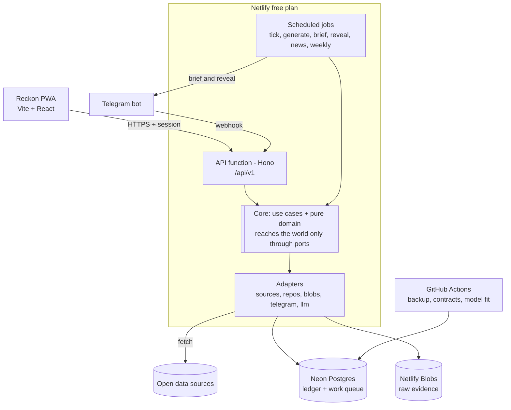
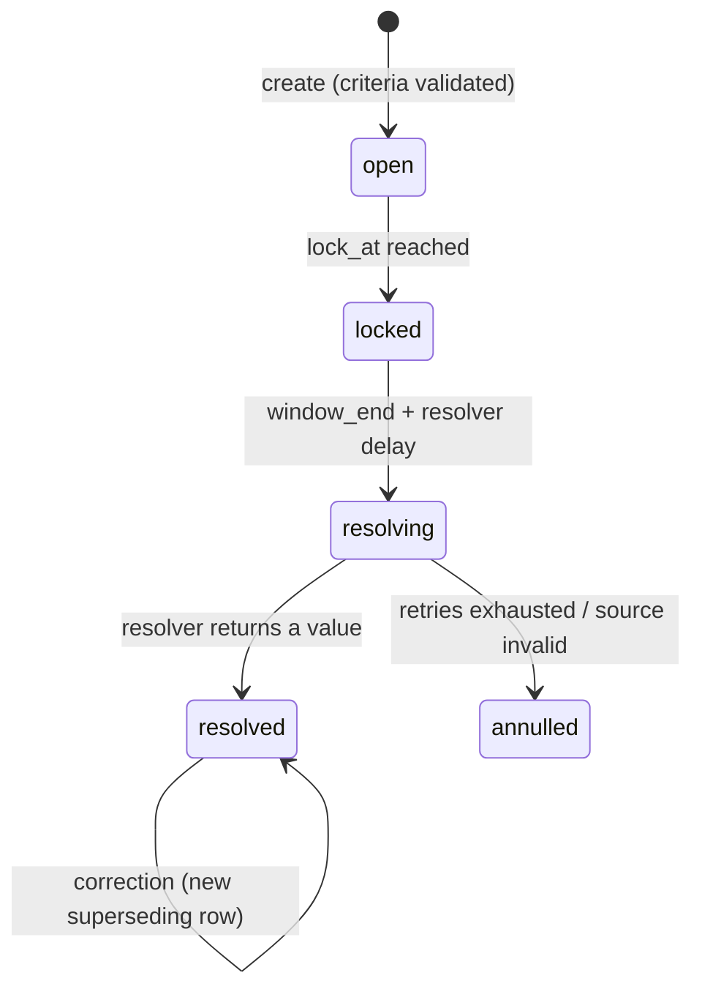

# 2. Architecture

Reckon is a TypeScript monorepo using a hexagonal (ports and adapters) architecture, deployed as a static PWA plus serverless functions on Netlify, with Postgres on Neon. Python appears only in Phase 4, for offline model fitting in GitHub Actions.

## 2.1 Stack decisions

| Layer | Choice | Reason |
| --- | --- | --- |
| Language | TypeScript 5 (strict) everywhere except offline ML | Netlify Functions run Node.js, TypeScript and Go, not Python. Shared types stop contract drift. |
| Monorepo | pnpm workspaces + Turborepo | Fast installs, cached builds, clear package boundaries. |
| Frontend | Vite, React 19, TanStack Query, Tailwind CSS v4, vite-plugin-pwa (TanStack Router, Motion and Recharts arrive in Phase 1–3) | Static build is almost free to serve. |
| API | Hono | Small, Web-standard; the same app runs on Cloudflare Workers if needed. |
| Validation | Zod schemas in `packages/contracts` | One schema validates API input, job payloads and criteria. |
| Database | Neon Postgres (free tier) via `pg`; Drizzle for typed queries; hand-written SQL migrations for DDL, triggers and grants | JSONB, window functions, SQL views, real triggers. |
| Blob storage | Netlify Blobs (Phase 1) | Raw API payloads stay out of the 0.5 GB database. |
| Scheduling | Netlify Scheduled Functions + a Postgres work queue | 30-second runs, so work is chunked and resumable. |
| Batch compute | GitHub Actions | Backups, contract tests, weekly model fitting. |
| Notifications | Telegram Bot API (primary), Web Push (secondary) | Free, reliable, inline buttons. |
| LLM (Phase 4) | A small, low-cost model behind an `LlmPort` | One more scored forecaster; never resolves questions. |
| Hosting fallback | Cloudflare Workers Paid ($5/month) + D1 | Only if Netlify's free credit cap becomes a real constraint. |

**Deployment:** the Netlify site serves `apps/web/dist`, the `/api/*` function and the scheduled functions in `netlify/functions`. Create the Neon project in AWS `us-east-2` to match Netlify's default function region (US East, Ohio). GitHub hosts the repo, CI, backups and model fits. Telegram reaches `/api/v1/telegram/webhook/:secret`.

## 2.2 Layering rules (enforced by dependency-cruiser in CI)

| Layer | Location | May import | Never imports |
| --- | --- | --- | --- |
| Domain | `packages/core/src/domain` | Domain and Zod | Anything with I/O |
| Application | `packages/core/src/app` | Domain, ports | Adapters, frameworks |
| Ports | `packages/core/src/ports` | Domain types | Implementations |
| Adapters | `packages/adapters` | Core (domain + ports), SDKs | Use cases |
| Delivery | `apps/*`, `netlify/functions` | Application layer, runtime | Other apps |

The **composition root** (`packages/runtime/src/compose.ts`) is the only place concrete adapters are wired into use cases. Plain constructor injection; no DI framework.

## 2.3 Design patterns

| Pattern | Where | Why |
| --- | --- | --- |
| Ports and adapters | Whole system | External services are swappable and testable with fakes. |
| Strategy | `Forecaster`, `Resolver`, `ThresholdSelector` | Interchangeable methods behind one interface. |
| Registry / plugin | Source, template and forecaster registries | A new topic is a registration, not a core change (G6). |
| Repository | `PgWorkQueue`, question and forecast repos | Use cases never see SQL. |
| Transactional outbox | `notifications_outbox` | Nothing lost or sent twice. |
| Work queue with leases | `work_items` | Survives the 30 s limit, crashes and retries. |
| State machine | Question lifecycle | Illegal transitions are impossible by construction. |
| Specification | `evaluate(criteria, observation)` | Resolution is a pure, testable function. |
| Pipeline | News ingestion | Fetch → normalize → dedupe → tag → link. |
| Result type | Use-case returns | Expected failures are values, not exceptions. |

## 2.4 Domain model

A **question** (what will be judged, and how) is separate from the **forecasts** made about it and the **resolution** that settles it. That separation makes honest comparison between forecasters possible.

| Entity | Meaning | Mutability |
| --- | --- | --- |
| Location | Named lat/lon with timezone | Editable; questions copy coordinates |
| Source | External data provider + health | Config plus health rows |
| Template | Recipe producing one kind of question | Versioned |
| Question | One binary claim with frozen criteria, lock time and window | Only status changes |
| Forecaster | Anything producing a probability | Versioned; new version = new row |
| Forecast | One p from one forecaster for one question at one time | Append-only |
| Evidence | Timestamped, hashed snapshot or news item | Append-only |
| Resolution | Outcome (1, 0 or annulled), observed value, evidence | Append-only; corrections supersede |
| Score | Brier and log score per forecast | Derived (SQL view) |

**Question lifecycle**

**Criteria** are a Zod discriminated union stored as JSONB with four kinds: `threshold`, `compare`, `count`, `event`. Every kind carries `source {id, version}` and `missingPolicy {retryUntilHours, thenOutcome: 'annul'}`. See `packages/core/src/domain/criteria.ts`.

**Schema:** the authoritative DDL is `packages/db/migrations/0000_init.sql`. Database-level integrity:

- `forecasts`, `evidence`, `resolutions` reject `UPDATE`/`DELETE` via trigger, and the `reckon_app` role only has `SELECT, INSERT` on them.
- A trigger rejects any forecast whose `made_at` is not before the question's `lock_at`.
- A trigger rejects changes to a question's criteria, hash, lock time or window.
- `scores` is a view joining the last pre-lock forecast per forecaster with the latest non-superseded resolution.

These rules are covered by `packages/db/test/integration.test.ts`.

## 2.5 API (spec §15)

Versioned JSON REST under `/api/v1`, one Hono app in one Netlify Function, validated by `packages/contracts`.

- **Auth:** single user. `POST /session` with a passphrase (scrypt hash in env, see ADR-0006) sets an HTTP-only, signed, `SameSite=Lax` cookie for 30 days.
- **Errors:** RFC 9457 problem details (`application/problem+json`) with stable `type` codes.
- **Pagination:** cursor-based. **Time:** ISO 8601 UTC. **Caching:** ETag on reads. **Rate limit:** 60 req/min; 5 login attempts per 15 min.

| Method | Path | Purpose | Phase | Status |
| --- | --- | --- | --- | --- |
| GET | `/health` | Database, queue depth, last job runs | 0 | Built |
| POST / DELETE | `/session` | Log in / out | 0 | Built |
| GET | `/me` | Settings, locations, stats | 0 | Built (minimal) |
| GET | `/brief/preview` | Live provider brief, labelled "learning" | 0 | Built |
| PATCH | `/me` | Update settings | 1 | Built |
| GET / POST / PATCH / DELETE | `/locations[/:id]` | Manage locations | 1 | Built |
| GET | `/brief/today` | Today's locked brief with champions and trust | 1 | Built |
| GET | `/reveal/:date` | Resolved questions, forecasts, scores (`latest` = yesterday) | 1 | Built |
| GET | `/questions`, `/questions/:id` | List (by date range, ≤ 31 days) and detail | 1 | Built |
| GET | `/questions/:id/evidence/:eid/raw` | Raw snapshot download | 1 | Built |
| POST | `/telegram/webhook/:secret` | Telegram updates | 1 | Built |
| POST | `/telegram/link` | One-time deep link for linking a chat | 1 | Built |
| GET | `/geocode?q=` | City search for onboarding | 1 | Built |
| GET | `/scoreboard`, `/scoreboard/calibration` | Brier per template and forecaster; reliability bins (`?forecaster=&template=`) | 2 | Built |
| GET / POST / DELETE | `/topics[/:id]` | Tracked news topics and one-tap suggestions | 2 | Built |
| POST / DELETE | `/push/subscribe` | Web Push subscription for this browser | 2 | Built |
| POST | `/questions`, `/questions/:id/forecasts` | Custom questions; "Call it" | 3 | |
| GET | `/reports/weekly/:isoWeek`, `/export` | Weekly report; data export | 3 | |
| POST | `/questions/:id/manual-resolution` | Answer a manual question | 5 | |

## 2.6 Engineering standards

- TypeScript `strict`, `noUncheckedIndexedAccess`, `exactOptionalPropertyTypes`; no `any`; external data enters only through Zod.
- Biome for lint and format; dependency-cruiser for layering; Vitest + fast-check for tests.
- Domain code is pure and deterministic: time via a `Clock` port, randomness via a seeded `Rng`.
- Expected failures return `Result<T, E>`; exceptions only for programmer errors.
- Naming: use cases are verbs (`drainWorkQueue`), ports are nouns, adapters are named after the technology (`OpenMeteoForecastAdapter`).

| Level | Tooling | Scope | Command |
| --- | --- | --- | --- |
| Unit | Vitest + fast-check | Domain maths, criteria, lifecycle, use cases, API routes | `pnpm test` |
| Adapter fixtures | Vitest with recorded responses | Every adapter parses real payloads; schema changes are detected | `pnpm test` |
| Integration | Vitest against Postgres | Migrations, triggers, queue leasing, job runs | `pnpm test:integration` |
| Live contracts | Vitest, nightly in CI | Real provider endpoints still match | `pnpm test:contracts` |
| End-to-end | Playwright + axe-core | Onboarding → brief → reveal on a fake clock, light and dark | `pnpm test:e2e` |

**CI/CD:** every PR runs lint, typecheck, depcruise, unit, integration (with a Postgres service) and build; Netlify builds a free deploy preview. Merges to `main` deploy to production (15 Netlify credits each), so day-to-day work happens on `dev`. Conventional Commits; ADRs in `docs/adr`; Definition of Done = code, tests, docs, accessible, observable, preview-deployed, phase criteria still passing.
