# 6. Phased release plan

Six phases take Reckon from an empty repo to a self-running, self-scoring daily companion in about 16 weeks at 10–12 focused hours per week. Every phase ends with a working, deployed app that is more useful than the last. Items already done in this scaffold are ticked.

```mermaid
gantt
  title Reckon roadmap (weeks)
  dateFormat X
  axisFormat W%s
  section Build
  Phase 0 Foundations          :p0, 0, 1
  Phase 1 Daily Brief MVP      :crit, p1, 1, 4
  Phase 2 World Pulse          :p2, 4, 7
  Phase 3 Scoreboard + habit   :p3, 7, 10
  Phase 4 Learning Reckon      :p4, 10, 13
  Phase 5 Life integration     :p5, 13, 16
  Phase 6 Decisions            :p6, 16, 18
```

## Phase 0 — Foundations (week 1)

**User value:** a live, honest preview brief already works; the skeleton deploys and reports its own health.

- [x] Monorepo (pnpm, Turborepo, Biome, strict TypeScript, dependency-cruiser rules).
- [ ] Create the Netlify site and Neon project (us-east-2); set environment variables. *(Your accounts; see GETTING_STARTED.md.)*
- [x] ADR-0001 to ADR-0007 in `docs/adr`.
- [x] `packages/db` migration with triggers and role grants (section 2.4).
- [x] `Clock`, `Rng`, `Result`, logger, composition root.
- [x] Work queue (enqueue, lease, complete, backoff) with integration tests.
- [x] Hono API with `/session`, `/me`, `/health`, and `/brief/preview`.
- [x] `tick` scheduled function writing `job_runs`.
- [x] CI (lint, typecheck, depcruise, unit + integration tests, build), nightly backup and contract workflows.

**Acceptance:** `/health` shows a successful `tick` in the last 2 hours; a backup artifact exists; a test proves forecasts cannot be updated or inserted after lock. *(Verified locally in the scaffold; repeat on Netlify + Neon after first deploy.)*

## Phase 1 — Daily Brief MVP (weeks 2–4)

**User value:** every morning a useful weather and air brief with honest probabilities; every evening a reveal of what happened.

- [x] Open-Meteo ensemble (ECMWF, 51 members) and archive (ERA5) adapters, plus past-day and geocoding; recorded fixtures; live contract tests.
- [x] Climatology cache (monthly refresh) feeding the threshold selector.
- [x] Templates: `wx.rain_any`, `wx.rain_adaptive`, `wx.tmax_adaptive`, `air.aqi_decision`, `air.aqi_adaptive` (`packages/core/src/domain/templates.ts`).
- [x] Forecasters: provider, ensemble, climatology, persistence (registry pattern, `packages/core/src/domain/forecasters.ts`).
- [x] Repositories for questions, forecasts, evidence, resolutions; Netlify Blobs evidence store (files locally).
- [x] Resolver `openmeteo.daily@1` with backoff and annul policy (ADR-0008).
- [x] Jobs: `generate`, `brief`, `reveal`; outbox sender inside `tick`.
- [x] Telegram bot: linking, brief and reveal messages, `/brief`, `/reveal`, `/pause` (plus `/resume`, `/stop`).
- [x] Web: onboarding, Today from `/brief/today`, Reveal card flips, Question detail with "How this is judged" and raw download; TanStack Router.
- [x] Trust badges read from the database (still "Learning").
- [ ] Deploy to Netlify + Neon and run for 7 days to meet the acceptance below. *(Your accounts; see GETTING_STARTED.md.)*

**Acceptance:** for 7 consecutive days the brief arrives on time with ≥ 4 items; ≥ 95% of questions resolve within 72 h; every resolved question shows raw evidence; Playwright E2E (onboarding → brief → reveal) passes on a fake clock. *(E2E passes in light and dark themes with axe-core checks (`pnpm test:e2e`); the 7-day live criteria need the deployment.)*

## Phase 2 — World Pulse and Evidence (weeks 5–7)

**User value:** the brief covers money, tech, space and world events, and every claim shows the news and data behind it.

- [x] Adapters: Frankfurter, USGS, NOAA SWPC, GitHub releases, Statuspage, GDELT, RSS, Hacker News (plus GFZ Potsdam for Kp history; ADR-0009). Each has a `SOURCE.md`, recorded fixtures and a live contract test. *(GDELT's fixtures are synthetic: the build sandbox could not reach it. Re-record from a normal network.)*
- [x] `history.rate` forecaster (and `provider.swpc@1`, NOAA's own storm probabilities).
- [x] Templates: `fx.usdinr_week`, `world.quake_m6_week`, `space.kp_storm_3d`, `tech.release_week`, `tech.incident_week`, `news.topic_surge` (`packages/core/src/domain/world-templates.ts`; windows and ladders in ADR-0009).
- [x] News pipeline (fetch, normalize, dedupe, tag, link, retain) and the `news` job.
- [x] "Why we believe this" panel; default topics; one-tap suggestions.
- [x] Scoreboard v1: Brier per template and forecaster; 5-bin reliability diagram.
- [x] Web Push fallback.
- [ ] Deploy and run until the acceptance below is met. *(Needs the Phase 1 deployment; set `VAPID_*` and optionally `GITHUB_TOKEN`.)*

**Acceptance:** ≥ 10 templates active; 100+ questions resolved; news on ≥ 50% of world and tech questions; no contract test red > 24 h without an open issue. *(11 templates are registered and each one generates on the fake clock; the nightly contracts workflow opens an issue on any failure. The resolved-question and news-coverage counts need the live run.)*

## Phase 3 — Honest Scoreboard and the Habit (weeks 8–10)

**User value:** the user sees what Reckon is genuinely good at, and has reasons to open it daily.

- [ ] Trust labels from `clusterBootstrapBss` and `trustStatus` (already implemented and tested in core).
- [ ] Champion selection with hysteresis.
- [ ] Calibration views: Wilson intervals, ECE, Murphy decomposition, horizon decay.
- [ ] Reveal animations; streaks with freezes; milestone badges.
- [ ] "Call it" in app and Telegram; You vs Reckon; calibration-based XP.
- [ ] Weekly report with "Surprise of the week".
- [ ] Custom questions via the guided criteria form; data export.

**Acceptance:** every on-screen probability shows a bootstrap-backed trust label; at least one template reaches a definitive label once 30+ clusters exist; the FX control never shows "Proven skill"; all engagement features can be switched off.

## Phase 4 — Learning Reckon (weeks 11–13)

- [ ] Python `ml/` project (uv); weekly `fit` workflow writing blend coefficients.
- [ ] Backtest harness replaying stored forecasts and evidence.
- [ ] `blend@1` forecaster in TypeScript reading coefficients from the DB.
- [ ] `llm.evidence@1` forecaster with the section 3.3 guardrails.
- [ ] Manifold crowd forecaster and `crowd.event` (low-trust flag); Wikimedia attention template.
- [ ] Optional LLM news tagging.

**Acceptance:** the blend beats the best single forecaster in backtest before release; new forecasters start as "Learning"; LLM spend < $1/month.

## Phase 5 — Life Integration (weeks 14–16)

- [ ] Todoist (read-only) and `life.task_deadline`.
- [ ] Google Calendar (read-only) and `life.plan_kept`.
- [ ] Manual-resolution prompts in Telegram: 3 per week, 72 h expiry.
- [ ] Personal Scoreboard bucket and a planning-fallacy view.
- [ ] Optional CPCB station data for air quality.

**Acceptance:** personal questions auto-resolve ≥ 80% of the time; ≤ 3 manual prompts in any week; personal results never mix into world statistics.

## Phase 6 — Decisions (after week 16)

- [ ] Decision cards generated only from templates labelled "Proven skill".
- [ ] Each card shows the probability, the action threshold and the justifying record.
- [ ] Retrospective: did following the cards help? Tracked as its own question type.

**Acceptance:** no decision card from a template without proven skill; evidence visible for every recommendation.

## Risks

| Risk | Likelihood | Impact | Mitigation |
| --- | --- | --- | --- |
| A source changes format or shuts down | Medium | Template's questions annul | Nightly contract tests; source health pauses the template; one package to replace. |
| Open-Meteo free terms change | Low | Weather core | Stay non-commercial; swappable adapter; paid API or a national service as fallback. |
| Netlify credit cap pauses the site | Low | Brief and reveal delayed | Budget in 05-operations; backfilling resolvers; $9 or $5 upgrade paths. |
| Correlated outcomes inflate skill | High without care | Over-confidence | Correlation groups and cluster bootstrap (built). |
| Overfitting the blend | Medium | False "proven" labels | Held-out backtests; champion hysteresis; FX control. |
| Engagement feels manipulative | Medium | Trust loss | Guardrails in 01-product; everything can be switched off. |
| Personal predictions change behaviour | Certain | Personal scores not comparable | Separate bucket; framed as self-insight. |
| Grid data disagrees with what the user saw | Medium | Frustration | "How this is judged" panel; audit cross-check; station data in Phase 5. |

## Open decisions (record each as an ADR when settled)

- [ ] Default brief and reveal times per region (current: 06:30 and 21:00).
- [x] Default RSS feeds, after checking each publisher's terms. *(ADR-0009: BBC News World and Technology, NASA, The Verge; Ars Technica and The Hindu excluded.)*
- [ ] Phase 4 LLM model and provider, on price and JSON reliability at that time.
- [ ] Whether to add a stock-index control template once a free, terms-compliant source exists.
- [ ] Whether Reckon should ever support multiple users.

## Glossary

| Term | Meaning |
| --- | --- |
| Question | A binary claim with frozen resolution criteria and a time window. |
| Criteria | The machine-readable rule deciding a question: source, metric, threshold, window. |
| Forecaster | Any named, versioned method that outputs a probability. |
| Champion | The forecaster currently shown for a template, chosen by track record. |
| Lock time | The moment after which no forecast for a question is accepted. |
| Resolution | The recorded outcome of a question, with its evidence. |
| Annulled | A question that could not be fairly resolved; excluded from scoring. |
| Brier score | Squared error between a probability and the 0/1 outcome; lower is better. |
| BSS | Brier skill score: improvement over climatology; above 0 beats the base rate. |
| Climatology | The historical base rate for a condition at a place and time of year. |
| Calibration | Whether events forecast at X% happen about X% of the time. |
| Correlation group | Questions whose outcomes are linked, scored as one cluster. |
| Evidence | A stored, hashed snapshot of source data or a news item. |
| Template | A recipe that generates one kind of question each day. |
